<div align="center">



<br/>

**[roundtableci.com](https://www.roundtableci.com)** · **[Rankings](https://www.roundtableci.com/rankings)** · **[Developers](https://www.roundtableci.com/developers)** · **[Learn](https://www.roundtableci.com/learn)**

</div>

---

## What we do

The same AI model comes in variants: a flagship, a mid tier, a cheap one. Which one holds up on *your* kind of task is usually a guess. We replace the guess with a record.

A small collector runs beside Claude Code and reports one thing per session: whether the tests passed, the model's tier, and how many test runs came after the first. **Labels and numbers, never prompts, code, file names or test output.** Reports are private unless you switch sharing on, and you can withdraw what you shared at any time.

From those outcomes we publish **rankings of variants within one family**, each row with the number of runs behind it. Reading the rankings is free.

## Try it

```bash
npx roundtableci setup      # adds the hooks, asks for your key with hidden input
npx roundtableci status     # is it reporting?
npx roundtableci credits    # your plan, credits left, what each call costs
npx roundtableci remove     # takes everything back out
```

Node 18 or newer. Keys come from [roundtableci.com/developers](https://www.roundtableci.com/developers#keys).

## Repositories

| | | |
|---|---|---|
| **[AthenaCI](https://github.com/RoundtableCI/AthenaCI)** | Open source | The research behind the core Roundtable idea: how to tell, from outcomes rather than claims, which model variant does a job well. Where the method started. |
| **roundtable-mcp** | Open source, coming soon | The collector and the `roundtableci` command line, plus the MCP server that lets an agent ask for guidance and report an outcome. |
| **[MerlinCI](https://github.com/RoundtableCI/MerlinCI)** | Public, early (Phase 0) | A self-hostable marketing operating system that shows its work: it discovers, decides, produces, distributes, measures and learns, inside permissions a person can pause, inspect and revoke. Written in Go. Not usable yet. |
| **Reflections** | Open source (MIT), coming soon | AutoEvolve, an earlier take on Reflections, built at a hackathon: agents that generate, critique and revise, prove with a zero-knowledge proof that a score went up, and leave memory on Sepolia that other agents can inherit and dispute. A hackathon build, not the production platform. |
| **RoundtableCI** | Private | The platform: Reflections, rankings, accounts and the API. |

## How we work

- **A count beside every claim.** A ranking without the number of runs behind it is an opinion.
- **Early means early.** Thin data is marked as thin, not rounded up.
- **Sample data is labelled** as sample data.
- **You decide what is shared.** Opt in, opt out, withdraw.

## Talk to us

Questions, a variant you want measured, or a collector problem: open an issue on the repo it concerns, or write through [roundtableci.com](https://www.roundtableci.com).

<sub>RoundtableCI is early. The record grows with every session people choose to share.</sub>
